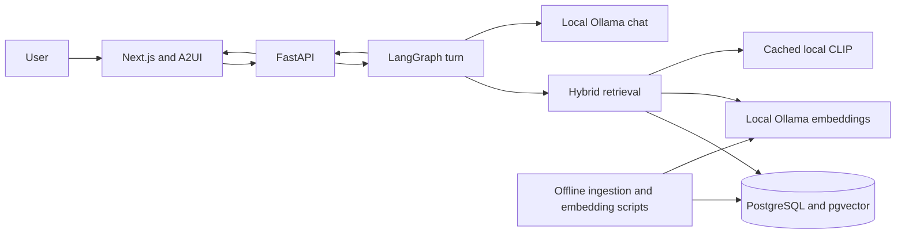

# System overview

## Purpose

This repository implements a local-first product discovery agent for an **Apparel & Accessories** catalog. It accepts a natural-language need, carries supported preferences and filters across turns, retrieves product candidates, and presents product cards through a web UI or terminal client. The source importer and SQL retrieval both enforce the apparel taxonomy.

## Capabilities

- Natural-language apparel discovery with Nomic text vectors and optional CLIP text-to-image ranking.
- Up to three displayed products can be selected as visual examples for a later retrieval turn.
- Deterministic category, brand, condition, title color/type, cart, and selection checks.
- Typed Ollama routing for messages that may change saved preferences or filters.
- PostgreSQL/pgvector catalog, vectors, and JSONB agent session snapshots.
- FastAPI endpoints and a Next.js/A2UI browser interface, plus a terminal harness and retrieval inspection command.
- Per-node trace metadata with durations/counts, excluding prompts, user messages, and product text.

## System boundaries

The Python API and Ollama are local host processes. Docker Compose runs PostgreSQL and the web UI. The CLIP encoder is loaded from the local Hugging Face model cache; text embeddings and chat use the local Ollama HTTP API. Offline scripts fetch sample data, ingest apparel records, and populate embeddings. No hosted inference service is part of the documented active design.

## Main technologies

| Area | Implementation | Role |
|---|---|---|
| API | FastAPI, Pydantic | Validate HTTP payloads and serialize results |
| Workflow | LangGraph | Route a turn through router, retrieval, and response nodes |
| State contracts | Pydantic v2 models | Constrain plans, router edits, summaries, and trace events |
| Persistence | PostgreSQL, pgvector, psycopg | Store products, vectors, and durable session state |
| Text model | Ollama `nomic-embed-text` | Product and query vectors |
| Image similarity | Transformers CLIP | Product image vectors and text/query or selected-example ranking |
| Chat model | Local Ollama model | Typed edit routing and optional grounded prose |
| UI | Next.js, React, CopilotKit A2UI renderer | Search/refine, select examples, view cards and cart |

## Important limits

The catalog does not have dependable price data, so price filtering is unsupported. The app has no arbitrary image upload flow. Image color and semantic preferences are not guaranteed by ranking; title filters use product titles and CLIP similarity is a relevance signal. The catalog size cited by current design docs is 2,173 products; this is documentation, not a live database count verified during this analysis.

## Source of truth

Implementation details are grounded in [workflow.py](../src/agent/workflow.py), [retrieval.py](../src/rag/retrieval.py), [api.py](../src/agent/api.py), [page.tsx](../src/ui/app/page.tsx), and [architecture.md](./architecture.md). Runtime services and database state were not started or queried during documentation authoring.
