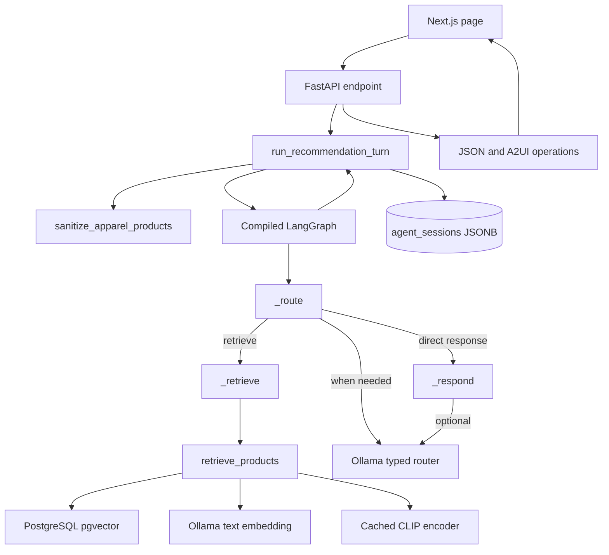

# Architecture

## Components

| Component | Responsibility | Main source |
|---|---|---|
| Request/API boundary | Pydantic validation, endpoint dispatch, image path resolution, response serialization | [src/agent/api.py](../src/agent/api.py) |
| Turn coordinator | Row-lock session, sanitize saved IDs, invoke graph, save JSONB snapshot | [src/agent/workflow.py](../src/agent/workflow.py) |
| Workflow nodes | Route edits/actions, retrieve candidates, produce user message | [src/agent/workflow.py](../src/agent/workflow.py) |
| Edit contracts | Pydantic plans and explicit edit records; atomic application | [src/agent/models.py](../src/agent/models.py), [src/agent/edits.py](../src/agent/edits.py) |
| Retrieval | Filter SQL candidates, query text/image spaces, fuse ranks and gate relevance | [src/rag/retrieval.py](../src/rag/retrieval.py), [src/agent/relevance.py](../src/agent/relevance.py) |
| Inference | Local Ollama JSON calls and embeddings; local CLIP text encoder | [src/agent/llm.py](../src/agent/llm.py), [src/rag/embed_text.py](../src/rag/embed_text.py), [src/rag/clip_runtime.py](../src/rag/clip_runtime.py) |
| A2UI bridge | Build surface operations and render ProductGallery | [src/agent/a2ui.py](../src/agent/a2ui.py), [src/ui/app/catalog.tsx](../src/ui/app/catalog.tsx) |

## Request and dependency diagram

## Graph and routing

The compiled graph is acyclic: `START -> router`, then conditional `retrieve` or `respond`; retrieval always proceeds to response, and response ends the turn. The router node handles reset, categories, actions, simple color refinements, and safe plain searches directly. Other messages call Ollama for a `TurnEdits` object; application code verifies evidence and applies edits to a copy of the plan. The model does not replace the full session snapshot.

## Persistence and concurrency

`run_recommendation_turn` validates the thread ID, opens a PostgreSQL connection, sets a five-second local lock timeout, inserts a session row if absent, then selects it `FOR UPDATE`. It sanitizes saved product references and invokes the graph while holding that row lock. It writes a JSONB snapshot while omitting current turn data, candidate lists, categories, uncertainty data, and trace events. This is application-managed persistence; the graph is compiled with an optional checkpointer parameter but the API constructs it without one.

## Retrieval decisions

- Every retrieval includes the Apparel & Accessories root predicate. Category, brand, condition, title color and product type filters are parameterized SQL.
- Nomic text and CLIP text-to-image candidate lists receive equal raw RRF weights when present. Missing ranking modes are normalized by the available total.
- Selected catalog examples are averaged into a normalized CLIP image vector and contribute an example rank.
- Strong-result filtering checks explicit colors and core text terms plus similarity thresholds. If no strong match survives, one fallback retrieval may relax title color/product constraints while preserving other hard filters.
- CLIP text encoding errors are logged and text retrieval can continue. Database or Nomic failures are not silently converted to empty results.

## Trade-offs and observed constraints

Exact pgvector ranking is used for the small catalog; no approximate index or reranker is implemented. The graph uses a single agent rather than multiple agents. Local inference avoids a hosted model dependency but makes model availability, cold-start time, and machine resources operational prerequisites. These are implementation characteristics; they do not imply measured performance.

## Error and retry behavior

`complete()` makes one Ollama request and validates output; it has bounded timeouts and no retry loop. Node wrappers log node name, error type, and elapsed time, then re-raise. Optional summary failures are caught so catalog cards remain usable. API handlers map database/runtime/value errors to HTTP responses (the exact endpoint mapping is detailed in [03_EXECUTION_WALKTHROUGH.md](./03_EXECUTION_WALKTHROUGH.md)).

## Evidence status

Diagrams and behavior above were checked against source. External calls, SQL execution, and runtime order were not exercised in this phase.
