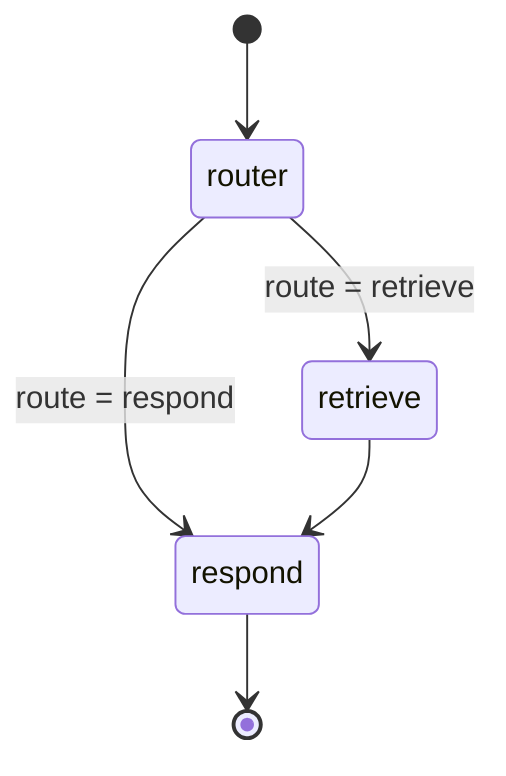

# LLM and agent flow

## Model configuration

`Settings` in [config.py](../src/agent/config.py) loads `.env` plus process environment. `DATABASE_URL` is required and wrapped as `SecretStr`. Ollama is restricted to loopback hostnames. The configured chat model defaults to `gemma3:4b`; text embeddings default to `nomic-embed-text`; CLIP defaults to `openai/clip-vit-base-patch32`. Router timeout defaults to 180 seconds; optional summaries default off.

## LangGraph state and edges

`RecommendationState` contains saved `plan`, `messages`, selected IDs, recommendations, cart, status/message, route, and per-turn fields. `candidates`, categories, trace, and current turn are transient in storage. This is one graph with three nodes, not a multi-agent system.

## Router call

The router node has deterministic shortcuts for reset/category requests, explicit API actions, complete color/count refinements, and plain searches that do not conflict with saved filters/exclusions. Otherwise it sends a `RouterRequest` to `complete(TurnEdits, ...)`. The prompt tells the model to return only explicit changes with exact evidence quotes, preserve untouched fields, avoid inventing IDs/catalog facts, and use clarify for ambiguous/unsupported price requests.

`complete` sends a single Ollama `/api/chat` request with a JSON Schema derived from the response Pydantic class, temperature zero, bounded output/context options, and `stream=False`. It parses response JSON with Pydantic. There are no retries or hidden agent loops. `apply_edits` performs deterministic evidence and conflict checks against the actual user message; router output is not trusted as application state by itself.

## Retrieval and context construction

The retrieval query joins the plan's main query and preference requirement strings. Nomic uses the search-query prefix; CLIP encodes the same natural-language context. SQL independently forces Apparel & Accessories and applies supported deterministic filters. Nomic and CLIP ranked lists are fused with reciprocal rank; selected visual examples add a CLIP image-example ranking. Application-level relevance gates then check text/color/product evidence and similarity thresholds. Exclusions expressed as recognized negated colors reject candidates, while many other preferences remain similarity guidance rather than verified facts.

## Response generation

The response node owns product ordering and card identity. Deterministic prose states count/result kind, possible fallback, unverified preference limitations, title-color caveat, and short result count. If summaries are explicitly enabled, `ExplanationRequest` passes the plan plus at most five product facts (description bounded to 1,200 characters). The prompt prohibits unsupported facts and product changes. `ModelError` is caught; recommendations remain available.

## Tool calls, memory, and checkpointing

The agent uses no LangGraph tools/tool-calling node. “Tools” in this application are deterministic Python functions and HTTP/database clients. Durable memory is the session JSONB snapshot managed by `run_recommendation_turn`, with a row lock per thread. Although graph construction accepts an optional LangGraph checkpointer, the API calls it without one. No separate vector memory or message summarization is used; recent message history is bounded to 20 user/assistant entries.

## Retry, failure, and observability

- Ollama typed completion: one request, bounded timeout, no retry.
- Nomic embedding: one HTTP call per embedding request; errors propagate.
- CLIP query encoding: retrieval catches `RuntimeError`/`ValueError`, logs a warning, and can continue using text results.
- Optional summary: `ModelError` is ignored.
- Each node wrapper appends timing and counts only after success; errors log node name/type/duration and re-raise. The trace omits user text, model prompts/output, and product copy.

The source exposes node duration and result counts, but no token usage is captured in the application trace. Latency and token estimates therefore should not be inferred from the code. Existing docs contain earlier measurements; they are not new measurements from this analysis.
