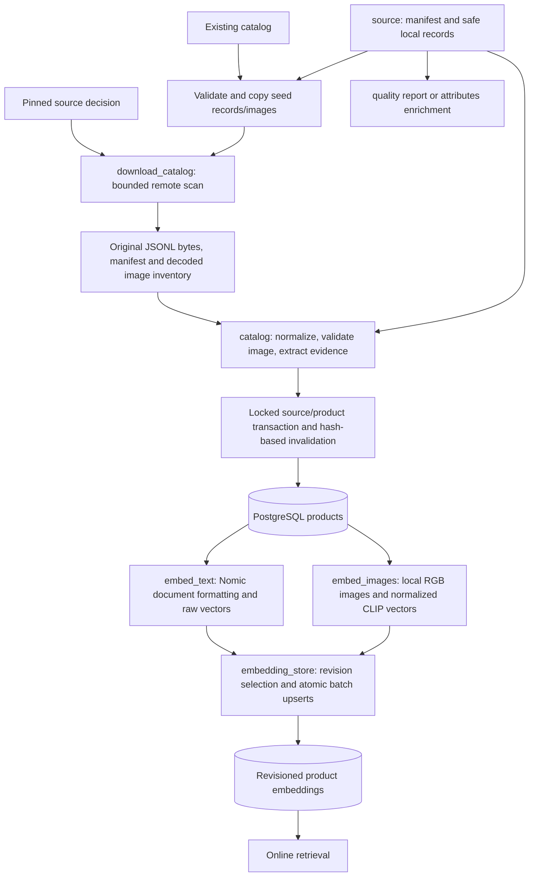
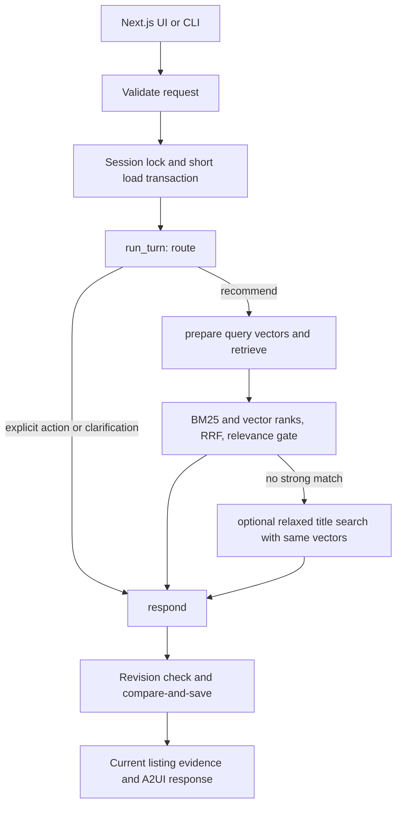

# Architecture

## Components and data flow

The application uses a direct Python turn workflow with local inference. PostgreSQL/pgvector and the Next.js web UI run in Docker; FastAPI and Ollama run on the host. Configuration is validated by `agent.config.Settings` from the project `.env` and process environment; `DATABASE_URL` is secret-wrapped. Compose binds services to loopback and retains the database volume.

```text
Pinned Amazon metadata + source manifest
  -> bounded acquisition and validated local images
  -> apparel normalization and transactional PostgreSQL import
  -> independent Nomic text and CLIP image embeddings

User text / selected catalog products
  -> FastAPI request validation
  -> one typed router decision with updated plan and validated search intent
  -> apparel-scoped BM25, text-vector and image-vector retrieval
  -> weighted RRF and relevance gate
  -> source-grounded cards, explanations, details and A2UI
  -> persistent sessions, visual selections and explicit cart actions
```

| Module | Responsibility |
| --- | --- |
| `rag.download_catalog` | Bounded HTTPS acquisition, image attempts and rejection reports |
| `rag.source` | Manifest schema, bounded local record reads and safe asset paths |
| `rag.catalog` | Metadata/image normalization, evidence extraction, provenance and transactional upserts |
| `rag.embed_text`, `rag.embed_images` | Modality-specific input preparation and offline encoding |
| `rag.embedding_store` | Shared pending-revision selection and atomic batch upserts |
| `agent.tools.embeddings`, `agent.tools.clip_runtime` | Shared validated local encoders |
| `agent.tools.retrieval`, `agent.tools.bm25` | Shared SQL eligibility, candidate scoring and RRF |
| `rag.phrases`, `rag.product_types` | Request/title evidence and conservative title-family matching |
| `agent.models`, `agent.conditions` | Typed state/turn/router contracts and unsupported condition detection |
| `agent.search_intent`, `agent.relevance` | Grounded interpretation and result eligibility |
| `agent.workflow` | Direct router/retrieval/response calls and safe trace events |
| `agent.sessions` | Snapshot normalization, advisory locks, guarded load/save transactions |
| `agent.api`, `agent.product_evidence`, `agent.a2ui` | HTTP interface, current listing evidence and UI operations |
| `src/ui/app/` | Shopping interface, product cards, details and session controls |

## Catalog and provenance

Only Apparel & Accessories is eligible. Source taxonomy is normalized from supported clothing, shoes, jewelry and accessory branches. Every retrieval query independently enforces the authoritative apparel root before limits. Category paths, brand and title filters use parameterized SQL.

The manifest pins source identity/revision, use evidence, normalization policy, original source lines and image inventory. IDs combine source namespace and upstream product ID. Import preserves source text/features/details and validates local decoded images without generating facts. Source-record and image hashes identify content changes separately; changed hashes invalidate vectors. Absent records are not deleted by import.

Acquisition is bounded by metadata lines/bytes, image bytes/attempts and wall time. HTTPS hosts, redirects and public DNS are checked. Oversized upstream lines are drained in bounded chunks; prepared records retain a 1 MB line cap. Filesystem assets are private under `.data/catalog/`; safe path resolution rejects traversal and symlink escapes.

`rag.attributes` extracts unreviewed source-evidence candidates with offsets and component/variant/measurement scope. `rag.quality` reports evidence quality and can enforce the manifest's optional `evidence-v2` policy. Neither module supplies verified runtime hard filters.

## Offline execution boundaries



Acquisition uses plain metadata and validated images; it does not extract attribute
candidates. Import adds the same extraction document before adapting JSON fields
to PostgreSQL `Jsonb` at `_upsert_product`. Raw source lines and image bytes, not
reserialized metadata, remain the invalidation keys. Existing imports of
`Manifest` and `local_asset` from `rag.catalog` continue to resolve directly to
`rag.source`; no compatibility wrapper or duplicate implementation is needed.

Local reporting/enrichment and seed reads share bounded record access. The importer
keeps its explicit stop reasons and rejected-record accounting. Remote acquisition
keeps its separate bounded oversized-line draining logic. These policies differ
intentionally. Publication keeps backup, prepare, journal, database commit and file
replacement in their existing order, with `_prepare_publication` naming the file
preparation stage. Recovery remains idempotent and hash checked.

Text/image jobs share pending-revision SQL and batch persistence, while keeping
their different input preparation and normalization. A batch fails atomically on
encoder cardinality mismatch or SQL errors; earlier committed batches remain.
The maintenance lock spans each job. No schema, encoder revision, source bytes,
input formatting, model weights or application dependencies changed in this
simplification, and it does not require rebuilding the catalog or vectors.

## Search and ranking

Textual application searches use a typed local LLM `SearchIntent`: a request-supported core product phrase, proposed equivalent search terms and quoted attributes. Phrase validation accepts supported regular inflections and joined/hyphenated spelling. Negated products cannot become positive intent; meaningful modifiers must be accounted for. Empty/unclear product intent remains within apparel-scoped semantic/lexical search.

A nonempty interpreted phrase must occur at a main-title segment boundary before candidate limits in every modality. Description-only or accessory-compatibility mentions do not establish the product. Proposed terms expand BM25 only; vector queries retain the original effective request. `prepare_query()` creates request-local Nomic/CLIP vectors and revision identities once, reused for primary and optional fallback SQL searches. No cross-session query cache is introduced. Saved interpretation is reused only when query and preference text are identical. Invalid extraction fails explicitly without a guessing fallback.

`retrieve_products` now reads in phases: validate inputs, build `_search_scope`,
browse or validate selected examples, gather modality ranks, then `_fuse_rankings`.
Shared scope is applied before candidate limits. SQL gates, Python phrase/family
checks and the workflow relevance gate remain separate correctness boundaries.
`product_phrase=None` allows family inference; an explicit empty phrase disables it.
Cart IDs are always excluded; selected examples are excluded unless a title-color
request permits them. Candidate projections retain existing optional field availability.

Direct retrieval and image-only searches can use conservative product-family checks. Explicit title-product filters take precedence; an image-only family is inherited only when every selected seed has the same known primary title type.

- **BM25:** source title, description and every feature bullet in the SQL-eligible corpus. Okapi parameters are k1=1.2 and b=0.75. Unicode token counts are cached by document text (4,096 entries); corpus statistics are cached for up to eight exact eligible document sequences. Current facts and filters are fetched on every search.
- **Nomic `nomic-embed-text`:** independent semantic ranking of document text against the effective request.
- **CLIP `openai/clip-vit-base-patch32`:** text-to-image ranking and normalized mean vectors from selected catalog examples. The cached local encoder loads lazily. Missing query CLIP allows the available text/keyword modes; selected examples require stored compatible image vectors.
- **Weighted RRF:** k=60; each nonempty query mode has base weight 0.50. Examples add base weight 0.20 with text or 1.0 for image-only search. Weights normalize over nonempty lists; each contribution is weight/(60+rank). Raw BM25 and cosine values are not added together. Candidate payloads expose raw scores and individual contributions.
- **Relevance:** exact requested text/color/type evidence and configured Nomic/CLIP cutoffs of 0.61/0.28 gate strong matches. Exact text can pass below a cutoff. If none pass, alternatives can relax title color/type while retaining category, brand and the interpreted phrase. Fewer than five results are allowed.

## State and evidence safeguards

The router returns the full updated plan and search interpretation in one call. Pydantic checks apparel paths, consistent filter-removal flags and grounded interpretation. Preserving untouched preferences and reconciling color replacements remain semantic responsibilities of the model; structural validation cannot prove it understood a request correctly. Explicit category/example/reset inputs update state directly. Cart actions bypass inference and preserve the search plan; cart items are removed from cards/selections and excluded by every retrieval query before limits. Removing a cart item restores its eligibility for subsequent searches.

Optional summaries use bounded supplied facts and have a 15-second network timeout; a summary failure preserves valid cards. Preferences and exclusions remain visibly unverified. Product details and match checks describe source text, not image truth or calibrated match probability.

Session turns acquire a nonblocking connection-scoped advisory lock for their thread. Inference runs outside transactions. Short repeatable-read load/save transactions and compare-and-save protect against overlaps, external snapshot edits and catalog changes. A competing or stale turn returns HTTP 409.

Saved JSON contains only durable shopping fields. Request inputs, candidates, categories, traces, route and the derived query_context are omitted. Resume derives query_context from Plan.query; older saved fields remain readable without a bulk migration.

Saved cards carry source-record/image hashes. Resume refreshes current apparel facts, removes invalid/changed recommendations and selections, and refreshes cart facts while clearing stale scores. Unsupported saved fields are sanitized before strict plan validation. Session rows and message history remain. Images are read from current product metadata.

Category counts use an eight-entry cache keyed by database identity and committed catalog revision. A statement trigger increments the revision for product writes, and a read-only repeatable-read snapshot reads the revision and counts together. Restart API workers after a database restore to discard process-local caches.

Vector SQL requires the query encoder's immutable revision and dimension. Nomic resolves the exact installed tag and checks it across encoding. CLIP uses the loaded snapshot revision; example seeds must agree on revision/dimensions. Incompatible vectors are excluded during incomplete rebuilds. Exact pgvector ranking is used at this catalog size.

Catalog writers share a maintenance advisory lock. Staged publication records metadata hashes in a recovery journal before import, then publishes prepared files under the same lock. Database commit and file replacement are not atomic; idempotent replay recovers interrupted publication. See [catalog maintenance](SETUP.md#catalog-maintenance-and-recovery).

## Limits and diagnostics

Price/budget and new/used condition filtering are unsupported. Arbitrary image uploads, approximate indexes, reranking and hosted inference are outside the application. Literal title evidence can reduce recall and cannot prove material, visual identity or correct semantic classification. The bounded sequential sample is not representative, and relevance quality has no independently judged benchmark. Administrative vector writes still require correct model/dimension metadata; optional preprocessing/input hashes are not populated by the encoder commands.

Each completed stage emits a safe per-turn trace with duration, route/status and result/modality counts. Traces omit prompts, user text, product descriptions and model reasoning, and are not persisted. See [agent behavior](Agent.md), [setup](SETUP.md) and [database contracts](database.md).

## Execution architecture



The former fixed three-node LangGraph added graph compilation, invoke/config
plumbing and an unused checkpointer option while session durability was already
application-owned. Direct calls now express the same branch and preserve named
router/retrieve/respond trace events. Session persistence has its own module;
runtime search functions no longer import offline embedding command code. No new
framework, model, ranking weights or relevance thresholds were introduced.

A2UI remains the UI protocol. `src/ui/app/a2ui.ts` contains the installed renderer's
internal imports and the single product schema; the TypeScript Product type is
inferred from it. Page and gallery components use that adapter.

See [walkthrough](walkthrough.md) for all request paths and the staged comparison.
